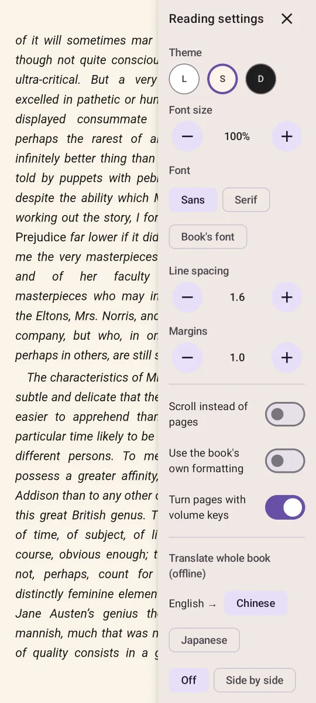

# WickReader 青灯

An e-book reader for Android with a tidy bookshelf, automatic series, 繁→简 conversion, on-device AI
read-aloud and translation. Everything runs on the phone: no account, no server, no tracking.

一个安卓电子书阅读器：整洁的书架、自动归类系列、繁体转简体、本地 AI 朗读与翻译。全部在手机上运行，无需账号，没有服务器。

**Download: <https://wick.qshlab.com>** (Android 8+, English and 中文). The app updates itself from there.

<p>
  
  
</p>

## Features

**Bookshelf**
- Grid / list / compact views; organize 按系列 (default) / 按书 / 按作者; sort by recently read / added,
  title (pinyin order), author, progress; filter by 在读 / 想读 / 未读 / 已读完, language, format; search
- 继续阅读 card for the book you're in the middle of
- Series grouped automatically (EPUB3 collections, `calibre:series`, and titles like 第二卷 / 卷三 / （三）/
  上中下 / Vol. 2 / Book 3), shown as stacks
- 整理系列: title-based suggestions for unlabeled books ("星海", "星海Ⅱ：暗潮" → 星海), confirmed by you
- Long-press to select several books: 设为系列 (with volume order), 想读, 已读完, delete; a series page
  has 整理 to rename / reorder / dissolve it
- 扫描手机: finds EPUB / TXT in shared storage (formats and TXT minimum size configurable), tick what to
  import; also multi-file / folder import, "open with" / "share to", and online catalogs (OPDS: Project
  Gutenberg built in with 中文书 / 日文书 shortcuts and 简→繁 search, add your own Calibre server)
- App settings (gear icon): AI voices, scan formats, reading defaults, storage use

**Formats**: EPUB; PDF (Readium + pdfium: pages, 目录, bookmarks, page / scroll, fit); converted to EPUB at
import: TXT / MD (UTF-8/16, GB18030/GBK, Big5; chapters detected), FB2 / FB2.ZIP (with series), DOCX
(headings or 第N章 lines become chapters), HTML, CBZ comics (fixed-layout pages). MOBI / AZW3 are
listed by the scan but not opened yet

**Interface**: English and 中文 (follows the phone, or pick in Settings → Language); string resources in
`res/values*/strings*.xml`

**Reading**
- Progress as 第 123 / 500 页 · 25% (Readium positions: fixed ~1 KB pages, so the count doesn't change
  with font size); paginated or scrolling; themes (日间 / 护眼 / 夜间), 黑体 / 宋体 / the book's font, size, line height,
  margins; volume keys turn pages (except while reading aloud)
- Books look alike: bold body text, odd sizes, letter spacing and heading fonts from the book's CSS are
  evened out (unless 使用书籍自带排版 is on)
- Settings open as a side panel, so the page reflows next to it while you adjust
- Per book: 横排 · 下一页在右, 横排 · 下一页在左, or 竖排 · 日式; Japanese books published vertical
  open that way. (横排 with the next page on the left keeps Readium left-to-right and reverses taps,
  swipes and the slider, because Readium mis-pages horizontal CJK right-to-left.)
- 目录 · 书签 · 笔记 (highlights with notes and colors), search inside the book
- 繁→简 per book or for all 繁體 books (OpenCC dictionaries; detected automatically)
- Select text → 查词/翻译 (offline ML Kit translation + any installed dictionary app), 高亮, 笔记, 复制
- 整本翻译: 双语对照 or 仅译文 into 中文 / English / 日本語 (chosen per book, also used by 查词/翻译),
  on-device, cached per chapter; read-aloud skips translation lines it has no voice for
- 朗读 with on-device AI voices (sherpa-onnx): Kokoro 中英文 (full-precision model, 100 voices, ~406 MB
  from Hugging Face), 标贝女声 (Matcha, very fast, ~131 MB), Amy English (21 MB); the phone's TTS engine
  for other languages. Whole sentences are synthesized ahead of playback (a lookahead walks the book
  with Readium's tokenizer), so there are no gaps or mid-sentence stalls once reading has started.
  Sentence highlighting, speed 0.5×–3×, voice choice with preview, screen-off playback, lock-screen controls

## Install

Download the APK from <https://wick.qshlab.com> on the phone and open it; allow "install unknown apps"
for your browser when Android asks. Or build it yourself (below) and `adb install -r` the APK.

Translation downloads each language model (~30 MB) the first time it's used, and needs Google Play
services (standard on phones sold outside mainland China).

## Download page and feedback

`site/` is the page at https://wick.qshlab.com: Cloudflare Workers static assets, plus `site/worker.js`,
which emails messages from the in-app feedback form (and the 何切道场 site's) through Cloudflare Email
Routing and keeps nothing. Publish a release with `./gradlew assembleRelease && site/deploy.sh`: it copies
the APK in (not kept in git), writes `version.json` (the in-app update check) and the `/download`
redirect, and deploys. It needs a one-time `cd site && npx wrangler@3 login`, and the feedback destination
address in `site/feedback-to.txt` (not in git).

## Build

```bash
cd reader-android
./gradlew assembleRelease          # signed if keystore.properties exists, else debug-signed
./gradlew testDebugUnitTest        # converter, series detection, TXT parsing
python3 tools/make_test_books.py /tmp/books   # sample EPUBs: series cases, Japanese vertical, heavy CSS
```

Needs JDK 17 and the Android SDK (platform 37). `gradle.properties` turns off any proxy set in
`~/.gradle/gradle.properties`; remove those two lines if you need one.

**Signing key**: `keystore/shelf-release.jks` + `keystore.properties` are not in git. Without them the
build is debug-signed, which is fine for your own use. (Android only installs an update signed with the
same key as the installed app.)

Quick testing without the file picker: `adb push book.epub /sdcard/Android/data/com.qshlab.shelf/files/inbox/`
and reopen the app; files there are imported on launch.

## Architecture

- Kotlin, Jetpack Compose (Material 3), Room (schema v4 with auto-migrations), DataStore
- [Readium Kotlin toolkit](https://github.com/readium/kotlin-toolkit) 3.4: EPUB parsing, navigator, search,
  TTS, OPDS. TXT is converted to EPUB at import (`data/TxtToEpub.kt`).
- 繁→简 and translation transform chapter HTML as it loads (`TransformingContainer`), never the file
- `reader/ReadAloudService` wraps the TTS player in a Media3 session for background playback
- `tts/AiTtsEngine` plugs sherpa-onnx into Readium's TTS navigator: one synthesis worker, the sentence
  being read first, then the next ~600 characters; `app/libs/sherpa-onnx-*-arm64.aar` is the official
  AAR trimmed to arm64. (The int8 Kokoro was dropped: slower than fp32 on ARM, and noisier.)
- `data/Converters` + `EpubBuilder`: FB2 / DOCX / HTML / CBZ → EPUB; `reader/PdfReaderActivity` for PDF
- `data/SeriesSuggester` (title-based series guesses) and `data/BookScanner` (phone scan)

## Not yet

- MOBI / AZW3, DJVU, CBR
- AI voices for Japanese and other languages (they use the phone's TTS engine)
- Reading statistics, cloud sync, backup / restore

## Credits

[Readium](https://github.com/readium/kotlin-toolkit) (BSD-3), [sherpa-onnx](https://github.com/k2-fsa/sherpa-onnx)
(Apache 2.0) with the Kokoro, Matcha (标贝) and Piper voices, [OpenCC](https://github.com/BYVoid/OpenCC)
dictionaries (Apache 2.0), [ML Kit](https://developers.google.com/ml-kit) translation, pdfium.

## License

WickReader's own code is MIT-licensed ([LICENSE](LICENSE)). The bundled libraries, voices and
dictionaries keep their own licenses (see Credits).
